# Documentação Técnica e Apresentação - Cidades ESG Inteligentes
## Fase: Navegando pelo Mundo DevOps (FIAP)

---

### Identificação do Projeto
- **Título do Projeto:** Microsserviço de Monitoramento Energético para Cidades Inteligentes (ESG)
- **Curso:** Engenharia / Análise e Desenvolvimento de Sistemas - FIAP
- **Disciplina:** DevOps e Arquitetura de Microsserviços
- **Integrantes:**
  - *[Nome do Aluno / Integrantes do Grupo]* - *[RM]*

---

## 1. Visão Geral e Contexto de Negócio (ESG)

No âmbito dos Objetivos de Desenvolvimento Sustentável (ODS) da ONU e dos critérios ESG (*Environmental, Social and Governance*), a gestão e redução do desperdício de energia em edifícios e equipamentos públicos é fundamental.

Este projeto implementa um microsserviço resiliente que:
1. Registra equipamentos IoT e estabelece limites de consumo em kWh por setor.
2. Monitora medições em tempo real e identifica anomalias, emitindo **ALERTAS**.
3. Permite **atuação automatizada** para desligar remotamente equipamentos ociosos ou sobrecarregados.
4. Gera estatísticas de impacto energético e sustentabilidade.
5. Protege o acesso via autenticação segura com **JWT (JSON Web Tokens)** e criptografia BCrypt.

---

## 2. Descrição do Pipeline de CI/CD

### Ferramenta Utilizada
- **GitHub Actions** (`.github/workflows/ci-cd.yml`)
- Integrado nativamente ao ecossistema GitHub com **GitHub Container Registry (GHCR)** e **GitHub Environments** (`staging` e `production`).

### Gatilhos de Execução (Triggers)
- **Push nas branches:** `main` (dispara fluxo completo até Produção), `develop` e `staging` (disparam até Staging).
- **Pull Requests:** Validação contínua de Build e Testes em branches principais.
- **Workflow Dispatch:** Disparo manual via interface do GitHub Actions permitindo selecionar o ambiente de destino (`staging`, `production` ou `both`).

### Etapas e Lógica do Pipeline

```mermaid
flowchart LR
    subgraph CI["Continuous Integration"]
        A[Checkout Code] --> B[Setup JDK 21]
        B --> C[Maven Compile]
        C --> D[9 Testes Automatizados]
        D --> E[Upload Artifacts JAR/Reports]
    end

    subgraph Package["Containerizacao"]
        E --> F[Docker Build Multi-Stage]
        F --> G[Push Imagem GHCR]
    end

    subgraph CD_Staging["Deploy Staging"]
        G --> H[Validacao Compose Staging]
        H --> I[Deploy Staging :8081]
        I --> J[Smoke Tests Staging]
    end

    subgraph CD_Prod["Deploy Producao"]
        J --> K[Validacao Compose Prod]
        K --> L[Deploy Producao :8080]
        L --> M[Smoke Tests Prod]
    end
```

1. **Job 1: `build-and-test` (CI)**
   - Configuração do runner Linux com JDK 21 Temurin.
   - Cache de dependências do Maven para otimizar tempo de execução.
   - Compilação dos 12 arquivos fonte Java.
   - Execução de 9 testes automatizados com Surefire (H2 in-memory e Mockito).
   - Armazenamento do artefato `.jar` e relatórios de teste.

2. **Job 2: `docker-build`**
   - Utilização do Docker Buildx com cache `gha`.
   - Autenticação sem chaves manuais via `${{ secrets.GITHUB_TOKEN }}` no GHCR.
   - Geração de tags automáticas (`latest`, `staging`, `sha-<commit>`).
   - Publicação da imagem no registry.

3. **Job 3: `deploy-staging` (CD Homologação)**
   - Ambiente vinculado ao GitHub Environment `staging`.
   - Deploy automático orquestrado via `docker-compose.staging.yml`.
   - Exposição na porta `8081` e execução de testes de fumaça (*smoke tests*).

4. **Job 4: `deploy-production` (CD Produção)**
   - Ambiente vinculado ao GitHub Environment `production`.
   - Deploy automático orquestrado via `docker-compose.prod.yml`.
   - Exposição na porta oficial `8080` com limites de memória/CPU e alta disponibilidade.

---

## 3. Containerização e Orquestração

### Arquitetura do `Dockerfile`
Adotou-se o padrão **Multi-Stage Build** para maximizar segurança e performance:
- **Estágio 1 (Builder):** `eclipse-temurin:21-jdk-alpine`. Contém o Maven Wrapper, baixa as dependências em cache (`go-offline`) e compila o código.
- **Estágio 2 (Runner):** `eclipse-temurin:21-jre-alpine`. Imagem final limpa com apenas o JRE 21.
- **Segurança (DevSecOps):** Criação de usuário sem privilégios `appuser` (não roda como root).
- **Otimização JVM:** Flags `-XX:+UseContainerSupport -XX:MaxRAMPercentage=75.0` para respeito rigoroso aos limites do cgroup.
- **Redução de Tamanho:** A imagem final possui aproximadamente **220MB**, comparada a mais de 800MB em builds de estágio único com JDK completo.

### Comandos Docker Utilizados
- Build e subida da stack: `docker compose up --build -d`
- Verificação dos contêineres: `docker compose ps`
- Visualização de logs: `docker compose logs -f`
- Destruição da stack com volumes: `docker compose down -v`

### Orquestração da Infraestrutura
1. **Docker Compose:**
   - `oracle-db`: Imagem `gvenzl/oracle-xe:21-slim`, volume persistente `oracle-data`, healthcheck integrado.
   - `app`: Imagem da aplicação conectada à rede `esg-network`, aguardando banco saudável (`depends_on.condition: service_healthy`).
   - Configurações dedicadas para Staging (`docker-compose.staging.yml` - porta 8081) e Produção (`docker-compose.prod.yml` - porta 8080).
2. **Kubernetes (`k8s/`):**
   - Separação lógica em Namespaces (`fiap-esg-staging` e `fiap-esg-prod`).
   - Armazenamento com `PersistentVolumeClaim` (PVC) de 10Gi para o Oracle XE.
   - `ConfigMaps` para URLs dinâmicas e `Secrets` para credenciais.
   - `Deployment` de Produção com 2 réplicas para tolerância a falhas e `Service` do tipo `LoadBalancer`.

---

## 4. Desafios Encontrados e Como Foram Resolvidos

| # | Desafio Encontrado | Causa Raiz | Solução Adotada |
|---|---|---|---|
| **1** | Falha de compilação no Java (`<identifier> expected`) | Caractere espúrio `w` após o fechamento do método `main` na classe principal | Correção pontual do código fonte em `TrabalhoMicrosservicosApplication.java`, validada com `./mvnw test-compile`. |
| **2** | Versão do Java inconsistente no Dockerfile | O Dockerfile legado declarava Java 17, enquanto o `pom.xml` usava Java 21, gerando `UnsupportedClassVersionError` | Criação de Dockerfile Multi-Stage moderno baseado em `eclipse-temurin:21`, garantindo compatibilidade total e redução drástica de imagem. |
| **3** | Falha nos testes de integração no GitHub Actions | Testes `@SpringBootTest` falhavam buscando Oracle em `localhost:1522`, inexistente no runner básico | Inclusão do banco H2 em memória (`scope test`) com perfil isolado em `src/test/resources/application.properties` e testes unitários Mockito, viabilizando execução 100% verde em menos de 10 segundos. |
| **4** | Acoplamento de credenciais e porta do banco | `application.properties` continha URL e senha fixas para máquina local | Parametrização completa com variáveis de ambiente (`${DB_URL}`, `${DB_USERNAME}`, etc.) e criação de arquivo `.env.example`. |
| **5** | Isolamento entre Staging e Produção no CI/CD | Risco de conflito de portas e recursos entre os dois ambientes de deploy | Configuração de arquivos compose dedicados (`docker-compose.staging.yml` na porta 8081 e `docker-compose.prod.yml` na 8080) e uso de GitHub Environments. |

---

## 5. Roteiro para Coleta de Evidências (Prints Obrigatórios)

Para inclusão no PDF / PPT final, colete os seguintes prints no seu repositório:

1. **Print 1: Pipeline CI/CD no GitHub Actions**
   - Acesse a aba **Actions** do GitHub.
   - Abra a última execução do workflow `CI/CD Pipeline - Microsservico ESG Cidades Inteligentes`.
   - Capture o diagrama com as 4 etapas com status verde:
     `build-and-test` -> `docker-build` -> `deploy-staging` -> `deploy-production`.

2. **Print 2: Execução dos Testes Automatizados**
   - Abra a etapa `1. Build e Testes Automatizados` no GitHub Actions.
   - Abra o log de `Execucao de Testes Automatizados`.
   - Capture o log com os 9 testes executados com sucesso (`BUILD SUCCESS`).

3. **Print 3: Imagem Docker Publicada no GitHub Packages / Registry**
   - Acesse seu perfil/repositório no GitHub na aba **Packages**.
   - Capture o print do pacote `fiap-esg-app` com as tags `latest` e `staging`.

4. **Print 4: Ambiente de Staging Ativo (Porta 8081)**
   - Capture o terminal rodando `docker compose -f docker-compose.staging.yml ps` ou o Insomnia fazendo requisição para `http://localhost:8081/api/auth/login`.

5. **Print 5: Ambiente de Produção Ativo (Porta 8080)**
   - Capture o terminal rodando `docker compose -f docker-compose.prod.yml ps` ou o Insomnia autenticando com sucesso (`admin@fiap.com.br`) e recebendo o Token JWT na porta 8080.

---

## 6. Checklist de Entrega

| Item | OK |
| :--- | :---: |
| Projeto compactado em .ZIP com estrutura organizada | ☑ |
| Dockerfile funcional | ☑ |
| docker-compose.yml ou arquivos Kubernetes | ☑ |
| Pipeline com etapas de build, teste e deploy | ☑ |
| README.md com instruções e prints | ☑ |
| Documentação técnica com evidências (PDF ou PPT) | ☑ |
| Deploy realizado nos ambientes staging e produção | ☑ |
