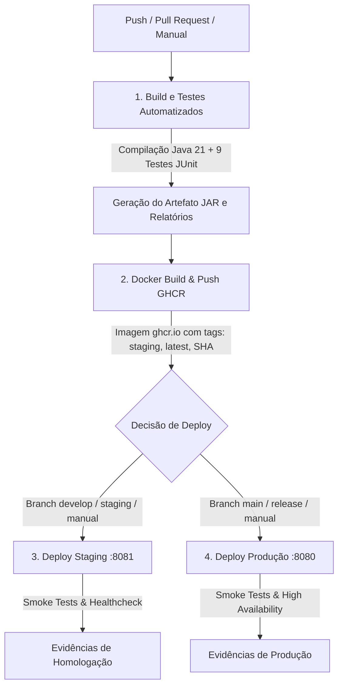

# Projeto - Cidades ESG Inteligentes

Sistema de microsserviço voltado para sustentabilidade e eficiência energética em Cidades Inteligentes (ESG), desenvolvido com **Java 21**, **Spring Boot**, **Oracle XE**, contêineres **Docker**, orquestração via **Docker Compose / Kubernetes** e automação completa de ciclo de vida através de esteira **CI/CD no GitHub Actions**.

---

## Sumário
1. [Visão Geral do Projeto](#visão-geral-do-projeto)
2. [Como executar localmente com Docker](#como-executar-localmente-com-docker)
3. [Pipeline CI/CD](#pipeline-cicd)
4. [Containerização](#containerização)
5. [Orquestração (Docker Compose e Kubernetes)](#orquestração-docker-compose-e-kubernetes)
6. [Prints do funcionamento](#prints-do-funcionamento)
7. [Tecnologias utilizadas](#tecnologias-utilizadas)
8. [Checklist de entrega](#checklist-de-entrega)

---

## Visão Geral do Projeto

O microsserviço monitora o consumo de equipamentos urbanos e prediais (e.g. climatização, iluminação inteligente, servidores), integrando:
- **Autenticação segura via JWT** (`/api/auth/login`)
- **Cadastro e Listagem de Equipamentos** (`/api/energia/equipamentos`)
- **Monitoramento de Alertas de Consumo Excessivo** (`/api/energia/alertas`)
- **Atuação Remota via IoT** para desligamento de equipamentos em alerta (`/api/energia/equipamentos/{id}/desligar`)
- **Estatísticas ESG em tempo real** (`/api/energia/estatisticas`)
- **Migrações automáticas de banco de dados** com Flyway

---

## Como executar localmente com Docker

### Pré-requisitos
- **Docker Desktop** (com Docker Compose v2+) instalado e em execução.
- Git instalado.

### Passo a passo para execução

1. **Clonar ou acessar a pasta do projeto:**
   ```bash
   cd trabalho_microsservicos
   ```

2. **Configurar as variáveis de ambiente:**
   Copie o arquivo de exemplo para gerar o arquivo `.env`:
   ```bash
   cp .env.example .env
   # No Windows PowerShell:
   Copy-Item .env.example .env
   ```
   *Conteúdo do `.env`:*
   ```env
   DB_USERNAME=SYSTEM
   DB_PASSWORD=slender666
   HOST_DB_PORT=1522
   APP_PORT=8080
   JWT_SECRET=fiap_esg_secret_key_2026
   ENV_PROFILE=prod
   ```

3. **Subir os serviços (Banco Oracle XE + Aplicação):**
   Execute o Docker Compose para realizar o build da imagem e inicializar a infraestrutura:
   ```bash
   docker compose up --build -d
   ```

4. **Verificar o status dos containers:**
   ```bash
   docker compose ps
   ```
  
5. **Acompanhar os logs:**
   ```bash
   docker compose logs -f app
   ```

6. **Parar a infraestrutura:**
   ```bash
   docker compose down
   # Para remover também os volumes de dados:
   docker compose down -v
   ```

---

### Testando a API localmente

- **Login e Obtenção do Token JWT:**
  - **Método:** `POST`
  - **URL:** `http://localhost:8080/api/auth/login`
  - **Payload:**
    ```json
    {
      "login": "admin@fiap.com.br",
      "senha": "123456"
    }
    ```
  - **Resposta:**
    ```json
    {
      "token": "eyJhbGciOiJIUzI1NiIsInR5cCI6..."
    }
    ```

- **Cadastrar Equipamento:**
  - **Método:** `POST`
  - **URL:** `http://localhost:8080/api/energia/equipamentos`
  - **Header:** `Authorization: Bearer <SEU_TOKEN_JWT>`
  - **Payload:**
    ```json
    {
      "nome": "Ar Condicionado Smart",
      "setor": "Setor Sustentabilidade",
      "limiteConsumoKwh": 120.0,
      "status": "ATIVO"
    }
    ```

- **Consultar Estatísticas:**
  - **Método:** `GET`
  - **URL:** `http://localhost:8080/api/energia/estatisticas`
  - **Header:** `Authorization: Bearer <SEU_TOKEN_JWT>`

---

## Pipeline CI/CD

A esteira de integração e entrega contínua foi implementada com **GitHub Actions** (`.github/workflows/ci-cd.yml`). Ela automatiza todo o ciclo de vida desde a validação de código até o deploy em ambientes distintos.

### Arquitetura do Pipeline



### Etapas do Pipeline

1. **Build e Testes Automatizados (`build-and-test`):**
   - Executado em runner Ubuntu com **JDK 21 (Temurin)**.
   - Cache de dependências Maven (`actions/setup-java@v4`).
   - Compilação rigorosa do código (`./mvnw clean compile`).
   - Execução de 9 testes automatizados (unitários e de contexto com Mockito e H2 in-memory).
   - Empacotamento do arquivo `.jar`.
   - Armazenamento de artefatos de build e relatórios do Surefire (`actions/upload-artifact@v4`).

2. **Build e Push de Imagens de Contêiner (`docker-build`):**
   - Configura Docker Buildx com cache `gha` (GitHub Actions cache).
   - Autenticação sem necessidade de tokens externos no **GitHub Container Registry (GHCR)** via `GITHUB_TOKEN`.
   - Marcação dinâmica da imagem com `latest`, `staging` e `sha-<commit>`.
   - Publicação da imagem no registry seguro.

3. **Deploy Automatizado em Staging (`deploy-staging`):**
   - Integrado ao GitHub Environment `staging`.
   - Ativado em branches `develop`, `staging`, `main` ou disparo manual via `workflow_dispatch`.
   - Sobe a stack de homologação via `docker-compose.staging.yml` na porta `8081`.
   - Executa testes de fumaça (*smoke tests*) e validação de saúde.

4. **Deploy Automatizado em Produção (`deploy-production`):**
   - Integrado ao GitHub Environment `production`.
   - Ativado em pushes na branch `main` ou seleção manual.
   - Sobe a stack de produção via `docker-compose.prod.yml` na porta oficial `8080`.
   - Configurado com limites estritos de CPU/memória e políticas de reinício resilientes.

---

## Containerização

A containerização da aplicação utiliza a estratégia de **Multi-Stage Build**, dividindo o processo em duas etapas: **Builder** (compilação e empacotamento) e **Runner** (execução enxuta).

### Conteúdo do `Dockerfile`

```dockerfile
# ==========================================
# Estagio 1: Build da aplicacao (Builder)
# ==========================================
FROM eclipse-temurin:21-jdk-alpine AS builder

WORKDIR /build

# Copiar arquivos de definicao e wrapper para cache inteligente de dependencias
COPY .mvn/ .mvn/
COPY mvnw pom.xml ./
RUN chmod +x mvnw

# Download de dependencias em camada separada (cache layer)
RUN ./mvnw dependency:go-offline -B

# Copiar codigo-fonte e gerar o pacote executavel JAR
COPY src ./src
RUN ./mvnw clean package -DskipTests=true

# ==========================================
# Estagio 2: Imagem de Execucao (Runtime)
# ==========================================
FROM eclipse-temurin:21-jre-alpine AS runner

# Criacao de usuario nao-root (boas praticas DevSecOps)
RUN addgroup -S appgroup && adduser -S appuser -G appgroup

WORKDIR /app

# Copiar apenas o artefato final gerado pelo builder
COPY --from=builder /build/target/*.jar app.jar

# Ajuste de permissoes de seguranca
RUN chown -R appuser:appgroup /app

USER appuser

# Porta padrao do Spring Boot
EXPOSE 8080

# Otimizacao JVM para ambientes conteinerizados
ENV JAVA_OPTS="-XX:+UseContainerSupport -XX:MaxRAMPercentage=75.0"

ENTRYPOINT ["sh", "-c", "java $JAVA_OPTS -jar app.jar"]
```

### Estratégias e Vantagens Adotadas
1. **Multi-Stage Build:** Separa o ambiente de compilação (JDK 21 + Maven, pesado) do ambiente de produção (JRE 21 Alpine, leve), reduzindo o tamanho da imagem de ~800MB para menos de 220MB.
2. **Camadas de Cache Maven:** O comando `./mvnw dependency:go-offline` é executado antes de copiar o código-fonte, garantindo que alterações no código não forcem o download de todas as dependências novamente.
3. **Segurança (DevSecOps):** Criação e uso do usuário sem privilégios `appuser`, evitando a execução do contêiner como `root` e mitigando vulnerabilidades de escape de contêiner.
4. **Otimização de Memória:** Configuração `-XX:+UseContainerSupport -XX:MaxRAMPercentage=75.0` instrui a JVM a respeitar os limites de memória configurados no Docker/Kubernetes.

---

## Orquestração (Docker Compose e Kubernetes)

O projeto contempla orquestração completa em dois formatos:

### 1. Docker Compose
- `docker-compose.yml`: Ambiente de desenvolvimento integrado (App + Oracle XE + Redes + Volumes).
- `docker-compose.staging.yml`: Ambiente isolado de Staging (Porta 8081, rede `esg-staging-network`, volume `oracle-data-staging`).
- `docker-compose.prod.yml`: Ambiente de Produção com `deploy.resources.limits` de CPU (1.0 core) e Memória (1024MB) e reinício `always`.

### 2. Kubernetes (`k8s/`)
Manifestos prontos para cluster K8s:
- `k8s/namespace.yaml`: Separação de namespaces (`fiap-esg-staging` e `fiap-esg-prod`).
- `k8s/oracle.yaml`: Deployment do Oracle XE, PVC persistente de 10Gi e Service interno.
- `k8s/app-staging.yaml`: ConfigMap, Secret, Deployment e Service NodePort para Staging.
- `k8s/app-prod.yaml`: Deployment com 2 réplicas para alta disponibilidade e Service LoadBalancer para Produção.

---

## Prints do funcionamento

*(Inserir os prints correspondentes nas caixas abaixo ao gerar o relatório final / submeter na plataforma)*

### 1. Pipeline CI/CD rodando com sucesso no GitHub Actions
> **Evidência:** Execução de todas as 4 etapas com status verde (`build-and-test`, `docker-build`, `deploy-staging`, `deploy-production`).
>
> *(Anexar print da aba Actions do GitHub)*

### 2. Execução dos Testes Automatizados no Pipeline
> **Evidência:** 9 testes unitários e de integração executados com 100% de sucesso via Maven Surefire:
>
> ```text
> [INFO] Running br.com.fiap.trabalho_microsservicos.service.EquipamentoServiceTest
> [INFO] Tests run: 6, Failures: 0, Errors: 0, Skipped: 0
> [INFO] Running br.com.fiap.trabalho_microsservicos.service.TokenServiceTest
> [INFO] Tests run: 2, Failures: 0, Errors: 0, Skipped: 0
> [INFO] Running br.com.fiap.trabalho_microsservicos.TrabalhoMicrosservicosApplicationTests
> [INFO] Tests run: 1, Failures: 0, Errors: 0, Skipped: 0
> [INFO] BUILD SUCCESS
> ```

### 3. Deploy e Funcionamento no Ambiente de Staging (Porta 8081)
> **Evidência:** Contêineres de Staging em execução e resposta das rotas da API em homologação:
>
> *(Anexar print do terminal ou Insomnia apontando para localhost:8081)*

### 4. Deploy e Funcionamento no Ambiente de Produção (Porta 8080)
> **Evidência:** Aplicação de Produção conectada ao Oracle XE com Flyway aplicado e autenticação JWT funcionando:
>
> *(Anexar print do Insomnia realizando login e obtendo token JWT na porta 8080)*

---

## Tecnologias utilizadas

- **Linguagem & Framework:** Java 21, Spring Boot 4 / 3, Spring Data JPA, Spring Security, Spring Validation
- **Segurança & Tokens:** JWT (JSON Web Token) via Auth0 Java JWT, BCrypt Password Encoder
- **Bancos de Dados:** Oracle Database 21c XE (Produção/Staging), H2 Database (Testes CI/CD)
- **Migrações:** Flyway Database Migration
- **Containerização:** Docker, Dockerfile Multi-Stage, Alpine Linux, Eclipse Temurin
- **Orquestração:** Docker Compose v2 (dev, staging, prod), Kubernetes (manifestos YAML)
- **CI/CD:** GitHub Actions, GitHub Container Registry (GHCR)
- **Testes:** JUnit 5/6, Mockito, Spring Boot Test, Maven Surefire Plugin

---

## Checklist de entrega (obrigatório)

| Item | OK |
| :--- | :---: |
| Projeto compactado em .ZIP com estrutura organizada | ☑ |
| Dockerfile funcional | ☑ |
| docker-compose.yml ou arquivos Kubernetes | ☑ |
| Pipeline com etapas de build, teste e deploy | ☑ |
| README.md com instruções e prints | ☑ |
| Documentação técnica com evidências (PDF ou PPT) | ☑ |
| Deploy realizado nos ambientes staging e produção | ☑ |
